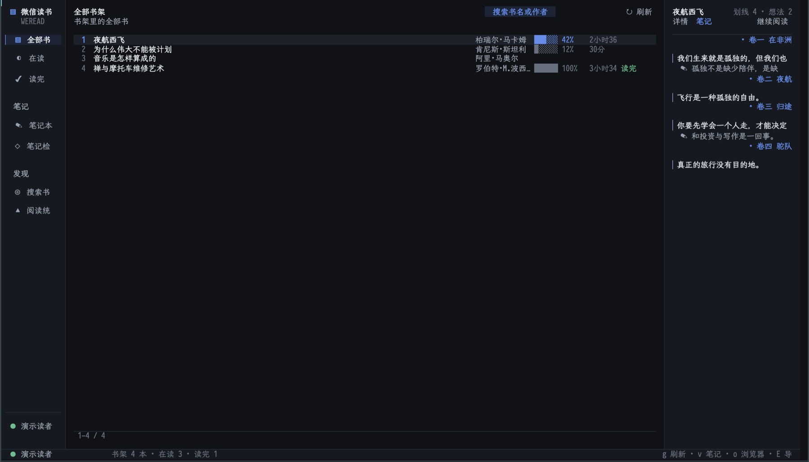

# ETAF Weread

ETAF Weread is a WeChat Reading (微信读书) client for Emacs. It renders the
signed-in account's shelf, notebook and reading statistics as one ETAF view: a
section sidebar, a paginated book list, a side pane with the book card, table
of contents and highlights, and a local SQLite index of every highlight through
ETAF DB.



## Capabilities

- Shelf: every book with progress, reading time and finished state, filtered by
  all, reading and finished.
- Notebook: the books that have highlights or thoughts, with per-book counts.
- Book detail: cover initial, author, category, rating, word count, progress
  meter, reading time, note counts, introduction-free card and the full table
  of contents.
- Highlights: quotes grouped by chapter with the attached thought below each
  quote, orphan thoughts collected separately.
- Store search: find books in the WeChat Reading store and open their detail.
- Reading statistics: finished and reading counts, total reading time, notes
  and the most-read books.
- Local highlight index: reading a book's highlights stores them in a SQLite
  database, and the index section searches the whole notebook offline; `I`
  walks and indexes the notebook in the background.
- Export: the selected book's highlights and thoughts are written as Markdown
  by the `weread` skill.
- Open in the browser: the selected book opens in the WeChat Reading web reader.
- Two palettes (dark and light) with one key, published as `:ui-*` theme tokens
  so shared ETAF UI controls follow the same colours.
- Window layouts: three columns on a wide frame, a glyph-only section rail with
  one pane on a medium one, and a phone-like stacked layout on a narrow one.
- Headless sessions for scripts and tests: no buffer, no timer and a scripted
  client are all supported.

## Prerequisites

Emacs 29.1 or newer, the `etaf`, `etaf-ui`, `etaf-db` and their Ebox/ECSS
providers on `load-path`, the built-in SQLite support of Emacs 29+, and the
`weread` backend skill with Node.js and a stored login.

## Installation

```elisp
(add-to-list 'load-path "/path/to/etaf")
(add-to-list 'load-path "/path/to/etaf-ui")
(add-to-list 'load-path "/path/to/etaf-db")
(add-to-list 'load-path "/path/to/ebox")
(add-to-list 'load-path "/path/to/ecss")
(add-to-list 'load-path "/path/to/etaf-weread")
(require 'etaf-weread)

(global-set-key (kbd "C-c r") #'etaf-weread-open)
```

`M-x etaf-weread-open` mounts the reader; `M-x etaf-weread-close` closes it.
`etaf-weread-skill-directory` points at the backend skill,
`etaf-weread-index-file` at the local SQLite database, and
`etaf-weread-theme-mode` selects the palette.

## Minimal example

```elisp
(require 'etaf-weread)

(let* ((reader (etaf-weread-create))        ; headless session
       (client (etaf-weread-make-client)))
  (plist-put reader :client client)
  (etaf-weread-refresh reader)              ; shelf, account and stats
  (while (plist-get (etaf-weread-state reader) :loading)
    (sit-for 0.05))
  (etaf-weread-move-selection reader 3)
  (etaf-weread-activate-selection reader)   ; the fourth book's detail
  (plist-get (etaf-weread-state reader) :detail))
```

## Runnable demo

`M-x etaf-weread-demo-open` mounts the complete reader on a scripted account,
so it needs no network, login or skill installation.
`M-x etaf-weread-demo-live` opens the same reader against the installed
backend. From a checkout with sibling providers:

```sh
cd etaf-weread
emacs -Q -L ../../ecss -L ../../ebox -L ../../etaf -L ../../etaf-ui \
  -L ../../etaf-db -L . -l examples/etaf-weread-demo.el -f etaf-weread-demo-open
```

## Documentation

- [The manual](docs/manual.md): keys, sections, the local index, theming,
  scripting, custom backends and troubleshooting.
- [Architecture](docs/architecture.md): module responsibilities, data flow and
  invariants.
- [The root entry Commentary](etaf-weread.el): the authoritative list of
  supported functions, variables, the app Component and the error type.

## Checks

`make check` runs the structure checker, byte compilation with warnings as
errors, the acceptance suite and the API boundary checker. The acceptance
scenarios drive a scripted backend and a temporary SQLite database, so they
need no network, login or frame:

```sh
make compile   # byte compilation, warnings are errors
make test      # the public acceptance scenarios
make check     # structure + compile + acceptance + API boundary
```
