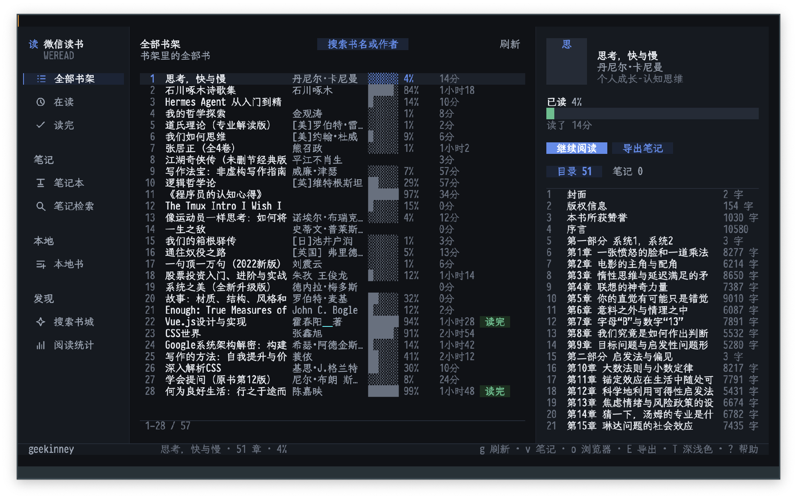
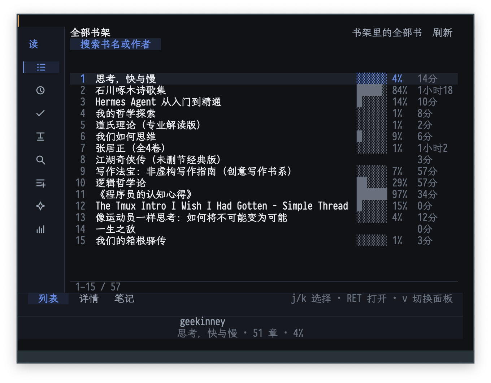
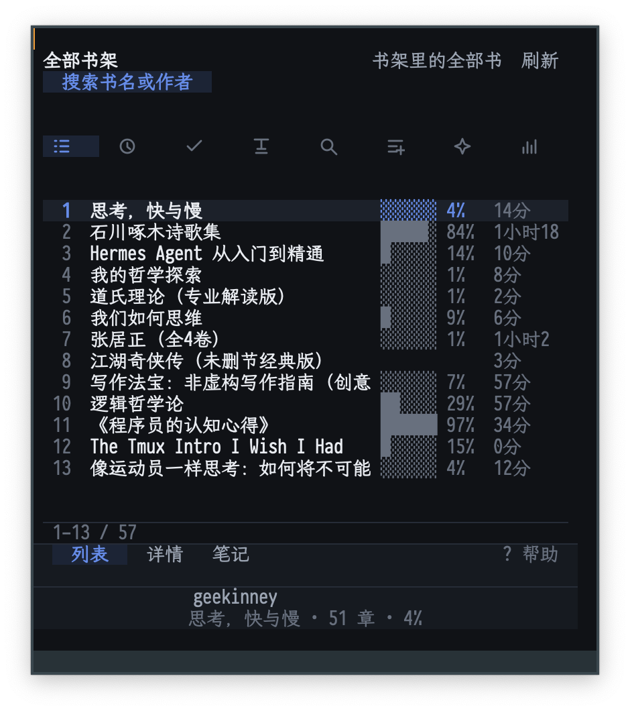

# ETAF Weread

ETAF Weread is a WeChat Reading (微信读书) client for Emacs. It renders the
signed-in account's shelf, notebook and reading statistics as one ETAF view: a
section sidebar, a paginated book list, a side pane with the book card, table
of contents and highlights, and a local SQLite index of every highlight through
ETAF DB.

The reader at a wide frame:



At a medium frame the sidebar becomes an icon rail and the side pane turns
into tabs:



At a narrow frame the sections become a chip strip and the panes stack under
tabs:



## Capabilities

- Shelf: every book with progress, reading time and finished state, filtered by
  all, reading and finished.
- Notebook: the books that have highlights or thoughts, with per-book counts.
- Book detail: cover initial, author, category, rating, word count, progress
  meter, reading time, note counts, introduction-free card and the full table
  of contents.
- Highlights: quotes grouped by chapter with the attached thought below each
  quote, orphan thoughts collected separately.
- Store search: find books in the WeChat Reading store and open their detail.
- Reading statistics: finished and reading counts, total reading time, notes
  and the most-read books.
- Local highlight index: reading a book's highlights stores them in a SQLite
  database, and the index section searches the whole notebook offline; `I`
  walks and indexes the notebook in the background.
- Local books: the `本地书` section lists the books in
  `etaf-weread-library-directory`, and a TXT, Markdown or EPUB file opens as a
  plain-text chapter that owns the frame body: centered columns (as many as
  fit, up to four, or `m` to pin a count), adjustable width (`[` / `]`), line
  and page scrolling, chapter jumps (`<next>` / `c`), a running head with the
  reading progress and an indent-aware Chinese layout.
- Export: the selected book's highlights and thoughts are written as Markdown
  by the `weread` skill.
- Open in the browser: the selected book opens in the WeChat Reading web reader.
- Three palettes (dark, light and sepia) with one key, published as `:ui-*`
  theme tokens so shared ETAF UI controls follow the same colours.
- Window layouts: three columns on a wide frame, a glyph-only section rail with
  one pane on a medium one, and a phone-like stacked layout on a narrow one.
- Headless sessions for scripts and tests: no buffer, no timer and a scripted
  client are all supported.

## Prerequisites

| Requirement | Why | Check |
| --- | --- | --- |
| Emacs 29.1 or newer | the ETAF runtime and the built-in SQLite support | `emacs --version` |
| Node.js 22 or newer | runs the backend client | `node --version` |
| `etaf`, `etaf-ui`, `etaf-db`, `ebox`, `ecss` | the framework; each root entry must be on `load-path` | every checkout is readable |
| `weread` backend | shelf, notes, login | the checkout's `scripts/weread.mjs` exists (see [The `weread` backend](#2-the-weread-backend)), or `pi-skill weread status` with Pi |

The reader displays what the backend provides: the `weread` skill owns the
account, the cookie and the highlight index, and the app keeps a local SQLite
mirror of every highlight it reads.

## Installation

### 1. System tools

```sh
brew install node                 # Node.js 22 or newer
```

Emacs 29.1 or newer is required; its built-in SQLite support stores the local
highlight index (no external database is needed).

### 2. The `weread` backend

The backend is an independent command-line package, published at
<https://forgejo.vhkd.top/pi-hub/weread>; the declared dependencies travel
inside the same checkout, so a plain clone runs as-is.  Clone it, check the
login and sign in once:

```sh
git clone https://forgejo.vhkd.top/pi-hub/weread.git ~/src/weread
SKILL=~/src/weread/skills/weread
node "$SKILL/scripts/weread.mjs" status                                 # reports a missing login
node "$SKILL/scripts/weread.mjs" login --from-chrome                    # macOS: reads the Chrome session
# or paste the two cookie values from a signed-in browser:
node "$SKILL/scripts/weread.mjs" login --cookie "wr_vid=…; wr_skey=…"
```

```elisp
(setq etaf-weread-skill-directory "~/src/weread/skills/weread")
```

WeChat Reading only offers QR login, so this step needs the user once.  The
cookie is stored at `~/.pi/agent/local/skills/weread/auth.json`; later reads go
straight over HTTP.

With Pi the same backend installs as a skill package —
`pi install git:forgejo.vhkd.top/pi-hub/weread@v0.2.1`, then
`pi-skill weread login` opens the controlled browser for the QR scan.  Writing
the reading place back to the account (`w`) drives the official web reader
through the same controlled browser, so that one command needs the complete Pi
skill setup; everything else works from the cookie alone.

### 3. The Emacs package

```elisp
(add-to-list 'load-path "/path/to/etaf")
(add-to-list 'load-path "/path/to/etaf-ui")
(add-to-list 'load-path "/path/to/etaf-db")
(add-to-list 'load-path "/path/to/ebox")
(add-to-list 'load-path "/path/to/ecss")
(add-to-list 'load-path "/path/to/etaf-weread")
(require 'etaf-weread)

(global-set-key (kbd "C-c r") #'etaf-weread-open)
```

`M-x etaf-weread-open` mounts the reader in the selected window; `M-x
etaf-weread-close` closes it.  `etaf-weread-index-file` selects the local
SQLite file and `etaf-weread-theme-mode` the palette.

### Quick start for an agent

A non-interactive path to a working reader (the QR scan needs the user once):

```sh
command -v node || brew install node
SKILL="${ETAF_WEREAD_SKILL_DIR:-$HOME/src/weread/skills/weread}"
test -f "$SKILL/scripts/weread.mjs" || {
  echo "weread backend not found: $SKILL (install it first: see 'The weread backend')" >&2; exit 1; }
node "$SKILL/scripts/weread.mjs" status || node "$SKILL/scripts/weread.mjs" login --from-chrome
```

```elisp
;; After adding the repositories to `load-path':
(require 'etaf-weread)
(etaf-weread-open)               ; real backend; returns the reader buffer
```

A missing client or an expired cookie leaves the reader mounted with the
backend error in its message line; sign in again through the backend (see "The
`weread` backend") and press `g` to retry.

## Minimal example

```elisp
(require 'etaf-weread)

(let* ((reader (etaf-weread-create))        ; headless session
       (client (etaf-weread-make-client)))
  (plist-put reader :client client)
  (etaf-weread-refresh reader)              ; shelf, account and stats
  (while (plist-get (etaf-weread-state reader) :loading)
    (sit-for 0.05))
  (etaf-weread-move-selection reader 3)
  (etaf-weread-activate-selection reader)   ; the fourth book's detail
  (plist-get (etaf-weread-state reader) :detail))
```

## Runnable demo

`M-x etaf-weread-demo-open` mounts the complete reader on a scripted account,
so it needs no network, login or skill installation.
`M-x etaf-weread-demo-live` opens the same reader against the installed
backend. From a checkout with sibling providers:

```sh
cd etaf-weread
emacs -Q -L ../../ecss -L ../../ebox -L ../../etaf -L ../../etaf-ui \
  -L ../../etaf-db -L . -l examples/etaf-weread-demo.el -f etaf-weread-demo-open
```

## Documentation

- [The manual](docs/manual.md): keys, sections, the local index, theming,
  scripting, custom backends and troubleshooting.
- [Architecture](docs/architecture.md): module responsibilities, data flow and
  invariants.
- [The root entry Commentary](etaf-weread.el): the authoritative list of
  supported functions, variables, the app Component and the error type.

## Checks

`make check` runs the structure checker, byte compilation with warnings as
errors, the acceptance suite and the API boundary checker. The acceptance
scenarios drive a scripted backend and a temporary SQLite database, so they
need no network, login or frame:

```sh
make compile   # byte compilation, warnings are errors
make test      # the public acceptance scenarios
make check     # structure + compile + acceptance + API boundary
```
